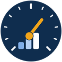

<p align="center">
  
</p>

<h1 align="center">Altímetro</h1>

<p align="center"><strong>Métricas de grupos de pesquisa a partir do Currículo Lattes</strong><br>
Windows · macOS · Linux · software livre (GPL-3.0)</p>

---

O Altímetro levanta, em poucos cliques, os números de um grupo de pesquisa para relatórios, editais, avaliações da CAPES e prestação de contas: produção bibliográfica e técnica, orientações, projetos, prêmios, bancas, eventos e a colaboração entre os membros, em qualquer período.

Você só informa o **ID Lattes** de cada membro. O programa baixa os currículos públicos, processa tudo com o [scriptLattes](https://github.com/jpmenachalco/scriptLattes) e mostra o resultado numa janela, com gráficos, tabelas e relatório pronto. Para quem não tem Lattes (um pesquisador estrangeiro, por exemplo), basta o **ORCID**: a produção vem do [OpenAlex](https://openalex.org).

## O que ele faz

- **Equipe:** quem está no grupo, com a foto do Lattes e os números de cada pessoa no período, e o botão para adicionar membros.
- **Página de cada membro:** visão geral (números clicáveis, produção por ano, parcerias no grupo), perfil (resumo, formação, linhas de pesquisa, áreas, idiomas) e as listas de publicações, eventos, orientações, projetos e outros. Exporta para Excel e gera um relatório individual.
- **Resumo:** artigos, trabalhos em eventos, livros e capítulos, orientações, projetos, produção técnica, prêmios, bancas e eventos, com a comparação com o período anterior de mesma duração ("▲ 30% vs 2017–2021").
- **Indicadores:** artigos por docente por ano, orientações por docente, colaboração interna (artigos com dois ou mais membros), artigos com DOI, membros com produção, periódicos distintos e projetos coordenados pelo grupo.
- **Gráficos clicáveis:** clique numa barra para ver os itens a que ela se refere (os artigos de 2023, as orientações de doutorado, os trabalhos de uma parceria...), com exportação. Organizados como a página de estatísticas de um grupo:
  - **Publicações:** por ano, artigos por ano, por membro, periódicos mais frequentes, por tipo;
  - **Orientações:** por nível, concluídas por ano, em andamento;
  - **Projetos:** iniciados por ano, ativos por ano;
  - **Produção técnica e artística:** por tipo e por ano;
  - **Eventos:** por ano, participações por tipo de evento, eventos mais frequentes;
  - **Prêmios e bancas**, **Membros** (produção por categoria, composição do grupo);
  - **Colaboração:** rede entre os membros, parcerias mais frequentes, membros mais conectados.

  Todos podem ser salvos em PNG ou SVG.
- **Tabelas:** por ano, por membro, orientações, projetos, periódicos e eventos. Um clique no cabeçalho ordena, e o botão direito copia (cola direto no Excel ou no Word).
- **Relatório:** um arquivo HTML com equipe, números, indicadores, gráficos, tabelas e um texto descritivo pronto. Abre no navegador e pode ser impresso ou salvo em PDF.
- **Excel:** todas as tabelas numa planilha.
- **Períodos prontos:** último ano, últimos 3, 5 ou 10 anos e os quadriênios da CAPES. Também dá para filtrar por categoria de membro (docentes, doutorandos, egressos...).

Um trabalho que aparece no currículo de mais de um membro conta **uma vez** para o grupo (pelo DOI ou pelo título e ano) e uma vez para cada pessoa.

## Instalação

Você precisa do **Python 3.9 ou mais novo** e do **Google Chrome**. O Chrome é usado para baixar os currículos, porque o Lattes só entrega a página a um navegador de verdade.

1. Baixe o projeto: botão **Code → Download ZIP** nesta página (e descompacte), ou

   ```sh
   git clone https://github.com/otaviozordan/altimetro-lattes.git
   ```

2. Abra pelo lançador do seu sistema:

   | Sistema | Como abrir |
   |---|---|
   | Windows | duplo clique em `Altimetro-Windows.bat` |
   | macOS | duplo clique em `Altimetro-macOS.command` (na primeira vez: botão direito → Abrir) |
   | Linux | `./altimetro-linux.sh` |

Na primeira vez, o lançador cria um ambiente Python só do programa (`.venv/`) e instala as bibliotecas, o que leva alguns minutos. Nas seguintes, abre direto.

<details>
<summary>Se faltar algo no Linux ou no macOS</summary>

- **Debian/Ubuntu:** `sudo apt install python3 python3-venv python3-tk`
- **Fedora:** `sudo dnf install python3 python3-tkinter`
- **Arch:** `sudo pacman -S python tk`
- **macOS:** prefira o Python do [python.org](https://www.python.org/downloads/macos/), que já vem com o Tkinter. Com Homebrew: `brew install python python-tk`.

Também dá para rodar à mão: `python3 iniciar.py`. Para reinstalar as bibliotecas: `python3 iniciar.py --instalar`.
</details>

## Como usar

1. **Novo grupo** (no alto) e dê o nome do grupo.
2. Em **Equipe → + Adicionar membro** (ou em **Gerenciar membros**), cole os IDs Lattes (16 dígitos) ou os links `http://lattes.cnpq.br/...`, um por linha, e escolha a categoria. Para quem não tem Lattes, cole o ORCID (`0000-0002-1825-0097`). O nome e a foto vêm do próprio currículo.
3. Clique em **Atualizar tudo**. O download leva uns 20 segundos por currículo, e a janela fica livre enquanto isso.
4. Escolha o **período** e as **categorias** no alto e navegue pelas abas.
5. **Salvar relatório** gera o HTML; **Exportar Excel** gera a planilha.

Para atualizar depois, use **Atualizar tudo** (baixa todos de novo) ou **Baixar só os novos**.

### Chave do OpenAlex (opcional)

Os membros cadastrados pelo ORCID vêm do OpenAlex, que funciona sem cadastro, mas divide uma cota diária entre todos que usam a mesma rede. Para não esbarrar nela, crie uma chave gratuita em [openalex.org/settings/api](https://openalex.org/settings/api) e cole em **Gerenciar membros → Chave do OpenAlex**.

## Privacidade

O Altímetro usa apenas dados **públicos** do Currículo Lattes e do OpenAlex. Tudo fica no seu computador, na pasta `grupos/`: currículos, fotos, relatórios e a lista de membros. Nada é enviado para servidor nenhum. A pasta `grupos/` está no `.gitignore`, para não ir parar num repositório por engano.

## Estrutura

| Arquivo | Papel |
|---|---|
| `iniciar.py` | prepara o ambiente na primeira vez e abre o programa |
| `altimetro.py` | a janela (Tkinter) |
| `nucleo.py` | grupos, download, leitura dos dados do scriptLattes, métricas, tabelas, texto e Excel |
| `graficos.py` | gráficos desenhados na tela, em SVG e em PNG a partir da mesma especificação |
| `relatorio.py` | relatório em HTML |
| `marca.py`, `marca/` | nome, cores e logo (`python marca.py` regera as imagens) |
| `scriptLattes/` | o scriptLattes, que baixa e processa os currículos |

Cada grupo fica em `grupos/<nome>/`, com `membros.json`, `cache/` (currículos), `fotos/`, `saida/` (o que o scriptLattes gera; `index.html` é o relatório completo dele) e `relatorios/`.

## Créditos e licença

Autoria:

- **Otávio Zordan Alves**, Engenharia Mecânica Aeronáutica · UNIFEI · [página no GEMEC](https://gemec.unifei.edu.br/membro/otavio-zordan-alves/) · [LinkedIn](https://www.linkedin.com/in/otavio-zordan)
- **Guilherme Ferreira Gomes**, Professor · Líder do GEMEC · UNIFEI · [página no GEMEC](https://gemec.unifei.edu.br/membro/guilherme-ferreira-gomes/) · [LinkedIn](https://www.linkedin.com/in/guilhermefergom/)

Feito no [GEMEC](https://gemec.unifei.edu.br), da UNIFEI (Universidade Federal de Itajubá).

O Altímetro é software livre, sob a [GNU General Public License v3.0](LICENSE): você pode usar, estudar, modificar e redistribuir, mantendo a mesma licença.

## Contribuir

Sugestões, problemas e melhorias são bem-vindos. Veja [CONTRIBUTING.md](CONTRIBUTING.md).
